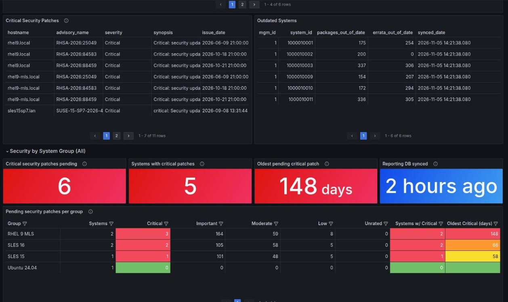
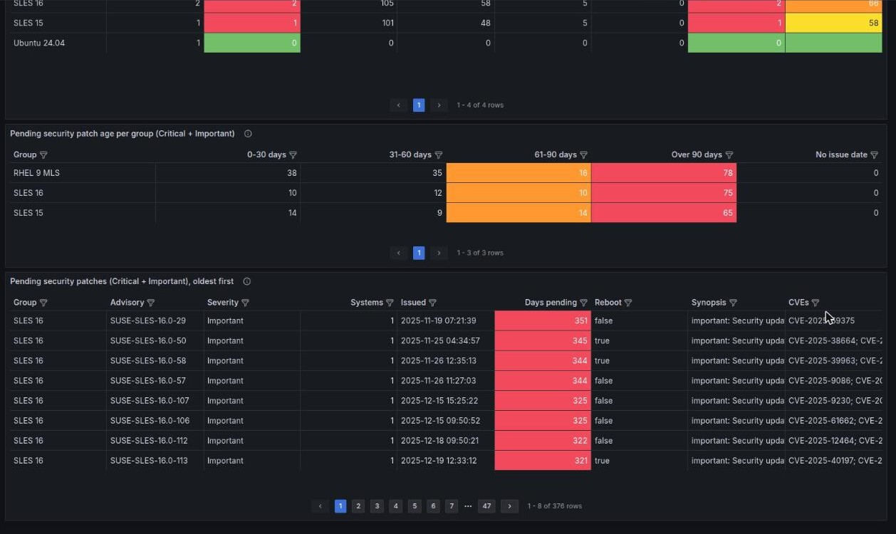

# Grafana dashboard: SUSE Manager General Reports

`suse-manager-general-reports.json` is the source of the
[SUSE Manager General Reports](https://grafana.com/grafana/dashboards/23039-suse-manager-general-reports/)
dashboard (grafana.com ID 23039).

Unlike the scripts in this repository, it doesn't use the XML-RPC API. It reads SUSE Multi-Linux
Manager's (SUSE Manager / Uyuni) **reporting database** (`reportdb`) through a Grafana PostgreSQL data
source.

## What's in it

* **Dynamic Stats**: systems with a given package installed, the latest 100 actions, and the latest 100
  package/patch operations.
* **Scheduled actions**: progress and results for one action ID.
* **Inventory**: kernel and OS distribution, group members, custom info, systems inventory, critical
  security patches and outdated systems.
* **Security by System Group**: the dashboard counterpart of `list_group_vulnerabilities.py`:
  * tiles: critical security patches pending, systems with critical patches, the oldest pending critical
    patch (days), and when the reporting database was last refreshed
  * pending security patches per group by severity (Critical/Important/Moderate/Low/Unrated), plus
    systems with critical patches and the oldest critical patch
  * patch age per group (0–30, 31–60, 61–90, over 90 days)
  * every pending security patch, oldest first, with systems affected, reboot flag and CVEs

  Use the **Groups** dropdown (multi-select, with "All") and the **Severity** filter (default Critical +
  Important) at the top to narrow it down. A system in several groups is counted in each one.

### Screenshots

Security tiles and per-group severity counts:



Patch age per group and the oldest-first patch list:



### Data freshness

The reporting database is not live. Taskomatic refreshes it with the `update-reporting-default` job
(daily by default), so the data can be up to a day old. The **Reporting DB synced** tile shows when it was
last refreshed. You can run the job on demand from *Admin → Task Schedules*.

## Preparing the SMLM server

Grafana connects straight to the reporting database, so check these on the SMLM server first.

1. **Port 5432 is published.** On containerized SMLM 5.x the reporting database listens on the host:

   ```
   ss -ltn | grep 5432
   ```

   From the machine that will run Grafana, `nc -zv <smlm-server> 5432` should succeed. If it doesn't,
   open the port in the server's firewall (`firewall-cmd --add-port=5432/tcp --permanent &&
   firewall-cmd --reload`), or use an SSH tunnel instead (`ssh -L 15432:localhost:5432 <user>@<smlm-server>`
   and point Grafana at `localhost:15432`).

2. **Credentials.** The reporting database name, user and password created at install time are in
   the server container's `rhn.conf`:

   ```
   podman exec uyuni-server grep ^report_db_ /etc/rhn/rhn.conf
   ```

   Use `report_db_name`, `report_db_user` and `report_db_password`. If your security policy requires
   it, create a dedicated read-only user for Grafana instead.

3. **TLS.** Start with SSL mode `require`. If the connection fails with a TLS error, your server
   doesn't offer TLS on that port: use `disable`, preferably over an SSH tunnel.

## Testing locally

This runs a throwaway Grafana on your machine against a real SMLM server. Nothing is installed on the
server, and the container keeps no data once it's removed. Requires Docker or Podman (replace
`docker` with `podman` below).

### 1. Start Grafana

```
docker run -d --rm --name grafana-test -p 3000:3000 grafana/grafana:10.4.15
```

Open http://localhost:3000 and log in as `admin` / `admin` (skip the password change).

### 2. Add the data source and import (web UI)

1. *Connections → Data sources → Add new data source → PostgreSQL*:
   * Host URL: `<smlm-server>:5432`
   * Database name: `reportdb`
   * Username / Password: `report_db_user` / `report_db_password` from `rhn.conf`
   * TLS/SSL Mode: `require`
   * Click *Save & test*: it should say "Database Connection OK".
2. *Dashboards → New → Import*: upload `suse-manager-general-reports.json` from this folder (or enter
   ID `23039` for the published version), and pick the data source from step 1 for both inputs.

### 2 (alternative). Do the same with the Grafana API

The same steps as one copy-paste block. It reads the credentials straight from the server over SSH,
so the password is never typed or printed. Run it from the root of this repository; `SMLM_SSH` must be
a user that can run `sudo podman` on the server.

```
export GRAFANA=http://localhost:3000 SMLM=smlm.example.com SMLM_SSH=root@smlm.example.com

# create the data source from the server's rhn.conf
ssh "$SMLM_SSH" 'sudo podman exec uyuni-server grep ^report_db_ /etc/rhn/rhn.conf' | python3 -c '
import json, os, sys
c = {k.strip(): v.strip() for k, v in (l.split("=", 1) for l in sys.stdin if "=" in l)}
print(json.dumps({"name": "smlm-reportdb", "uid": "smlm-reportdb",
                  "type": "grafana-postgresql-datasource", "access": "proxy",
                  "url": os.environ["SMLM"] + ":5432", "user": c["report_db_user"],
                  "jsonData": {"database": c["report_db_name"], "sslmode": "require",
                               "postgresVersion": 1600},
                  "secureJsonData": {"password": c["report_db_password"]}}))' |
  curl -s -u admin:admin -H 'Content-Type: application/json' "$GRAFANA/api/datasources" -d @-; echo

# check the connection: expect "Database Connection OK"
curl -s -u admin:admin -X POST "$GRAFANA/api/datasources/uid/smlm-reportdb/health"; echo

# import the dashboard, mapping its data source inputs to smlm-reportdb
python3 -c '
import json
d = json.load(open("grafana/suse-manager-general-reports.json"))
print(json.dumps({"dashboard": d, "overwrite": True,
                  "inputs": [{"name": i["name"], "type": "datasource",
                              "pluginId": "grafana-postgresql-datasource",
                              "value": "smlm-reportdb"} for i in d["__inputs"]]}))' |
  curl -s -u admin:admin -H 'Content-Type: application/json' "$GRAFANA/api/dashboards/import" -d @-; echo
```

Then open `$GRAFANA/d/cef15qpk4ccu8b`.

### 3. Clean up

```
docker stop grafana-test
```

## Using an existing Grafana

Same as the local test: add the PostgreSQL data source (see *Preparing the SMLM server* for host,
credentials and TLS), then import the dashboard by ID `23039` or from the JSON file.

To manage the data source as code, use a Grafana provisioning file (for example
`/etc/grafana/provisioning/datasources/smlm-reportdb.yaml`). Grafana expands environment variables
in provisioning files, so the password can come from the environment:

```yaml
apiVersion: 1
datasources:
  - name: smlm-reportdb
    uid: smlm-reportdb
    type: grafana-postgresql-datasource
    url: smlm.example.com:5432
    user: pythia_susemanager        # report_db_user from rhn.conf
    jsonData:
      database: reportdb
      sslmode: require
      postgresVersion: 1600
    secureJsonData:
      password: $SMLM_REPORTDB_PASSWORD
```

Import the dashboard through the UI or the API afterwards. Don't provision the JSON file directly:
it uses `${DS_...}` import placeholders and a library panel, which only the import path resolves.

The file keeps the published dashboard's uid. If the dashboard is already imported, Grafana will
offer to overwrite it; import into another folder or change the name/uid to keep both.

## Updating the published dashboard

Edit the dashboard in Grafana, then *Share → Export → Export for sharing externally* (this keeps the
`${DS_...}` placeholders instead of your local data source uid), save it over
`suse-manager-general-reports.json`, commit, and upload it as a new revision on grafana.com.
